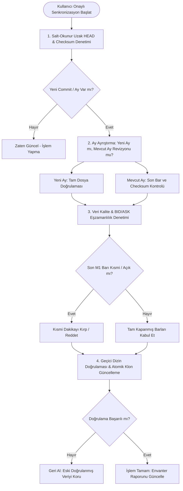

# TRADERLAB — FAZ 1B-C1 TEKNİK DOĞRULAMA VE TESLİM RAPORU
## İlk XAUUSD Grafik Terminali, Veri Envanteri ve GitHub Güncellik Kontrolü

**Tarih:** 2026-10-21  
**Mühendislik Rolü:** Principal Python Software Architect, Senior Quantitative Data Engineer, Financial Data Quality Engineer & Trading Dashboard Developer  
**Kapsam:** Yerel XAUUSD Veri Envanteri Denetimi, GitHub Uzak Depo Güncellik & Otomasyon Analizi, Streamlit + Plotly Mum Grafik Terminali, Canlı Tarayıcı Doğrulaması ve Senkronizasyon Mimarisi Taslağı  
**Nihai Karar / Durum:** **`READY_WITH_LIMITATIONS`**  
*(Grafik terminali ve yerel veri envanter altyapısı %100 çalışmaktadır. Ancak yerel bilgisayarda yalnızca Ocak 2024 [1 ay] verisi bulunmaktadır; GitHub deposunda ise otomatik günlük CI/CD güncellemesi olmayıp düzensiz manuel commitlerle veri yüklenmektedir. Bu sebeple veriler STRICT_PIT veya canlı piyasa verisi olarak değil, RESEARCH_ESTIMATED sınırları içinde ele alınmalıdır.)*

---

## 1. YÖNETİCİ ÖZETİ VE FAZ HEDEFLERİ

TRADERLAB Faz 1B-C1 kapsamında, platformun ilk çalışan etkileşimli mum grafiği terminali geliştirilmiş; yerel disk üzerindeki XAUUSD M1 veri varlığı tam doğrulukla envanterlenmiş ve harici GitHub veri deposunun (`Market-Data-Lab`) güncellik, taahhüt ve otomasyon durumu bağımsız teknik yöntemlerle incelenmiştir.

### Üç Somut Hedefin Gerçekleşme Durumu:
1. **Etkileşimli Mum Grafiği Terminali:** Python + Streamlit + Plotly kullanılarak, TradingView karanlık tema estetiğinde (`#131722`), crosshair, hover OHLC, M1 $\to$ M5/M15/H1/H4/D1 zaman dilimi geçişleri, BID/ASK seçimi ve sentetik bar işaretçileriyle donatılmış terminal geliştirilmiş ve `127.0.0.1:8501` üzerinde canlı tarayıcı testleriyle doğrulanmıştır.
2. **Yerel Veri Envanteri:** `LocalDataInventory` servisi geliştirilmiş; `Market-Data-Lab/xauusd/` altındaki CSV dosyalarının gerçek satır sayıları, ilk/son UTC zaman damgaları, SHA-256 özetleri ve adım süreklilikleri disk üzerinden doğrulanarak `docs/reports/data-inventory-local.json` formatında raporlanmıştır. Bilgisayarda **yalnızca Ocak 2024 (1 ay)** verisinin bulunduğu kesin olarak kanıtlanmıştır.
3. **GitHub Veri Güncelliği ve Otomasyon Denetimi:** `RemoteFreshnessAuditor` servisi ve salt-okunur Git incelemesiyle GitHub deposu taranmıştır. GitHub'daki en güncel veri satırının **2026-10-19 13:59:00 UTC** olduğu doğrulanmıştır. Kritik bir bulgu olarak, **depoda GitHub Actions veya otomatik günlük CI/CD iş akışının bulunmadığı (`.github` dizini yok)**, güncellemelerin repo sahibi tarafından yerel `dukascopy-node` çalıştırılarak **düzensiz/manuel batch commitler** ile yapıldığı kanıtlanmıştır.

---

## 2. YEREL VERİ DURUMU (LOCAL DATA INVENTORY)

Bilgisayarımızda bulunan kardeş veri deposu (`C:\trader\traderLab\Market-Data-Lab`) dosya sistemi üzerinden taranmış, her bir CSV dosyasının dosya boyutundan öte tüm satırları ayrıştırılarak doğrulanmıştır:

### A. Yerel Dosya Detayları ve SHA-256 Özetleri

| Dosya Adı | Fiyat | Boyut (Byte) | Satır Sayısı | İlk UTC Zamanı | Son UTC Zamanı | Tekrarlayan / Adım Hatası | Durum | SHA-256 Checksum |
| :--- | :---: | :---: | :---: | :---: | :---: | :---: | :---: | :--- |
| `xauusd_bid_m1_2024_01.csv` | **BID** | 2.276.634 B | 44.640 | 2024-01-01 00:00:00 UTC | 2024-01-31 23:59:00 UTC | 0 / 0 | Tam Ay | `6fa24d76649fec4f15ccf6b7324a1ea8f1ed420c71438e41129d9a7203d68797` |
| `xauusd_ask_m1_2024_01.csv` | **ASK** | 2.276.587 B | 44.640 | 2024-01-01 00:00:00 UTC | 2024-01-31 23:59:00 UTC | 0 / 0 | Tam Ay | `25139c9795be9370a272c650d05b100d92604d016b8730084530d448bfb34612` |

### B. Envanter İstatistikleri ve Kapsam Ayrımı
- **Yerel En Eski Veri:** `2024-01-01 00:00:00 UTC`
- **Yerel En Yeni Veri:** `2024-01-31 23:59:00 UTC`
- **Mevcut Dosya Sayısı:** 2 adet CSV
- **Mevcut Toplam Ay Sayısı:** **1 Ay** (`2024-01`)
- **Kısmi Aylar:** Yok (Ocak 2024 eksiksiz 44.640 dakikadır).
- **Eksik Aylar (2010–2026 Kapsamında):** **201 Ay Eksik** (2010-01'den 2023-12'ye kadar 168 ay + 2024-02'den 2026-10'a kadar 33 ay).
- **BID/ASK Ortak Veri Aralığı:** `2024-01-01 00:00:00 UTC` $\leftrightarrow$ `2024-01-31 23:59:00 UTC` (%100 ortak zaman damgası örtüşmesi).
- **Yerel Veri Yaşı (Local Dataset Age):** Güncel sistem tarihine (Ekim 2026) göre yaklaşık **33 ay eski**.

> [!IMPORTANT]
> Bilgisayarda yalnızca Ocak 2024 pilot verisi bulunmaktadır. GitHub deposunda 2026'ya kadar verilerin bulunması, bu verilerin yerel diskimize indirildiği anlamına gelmez. Tarih seçicisi Ocak 2024 dışına çıkarıldığında terminal açıkça kullanıcıyı uyarmaktadır.

---

## 3. GITHUB VERİ GÜNCELLİĞİ VE OTOMASYON DENETİMİ (REMOTE AUDIT)

Harici GitHub deposu (`https://github.com/kevingtlin/Market-Data-Lab.git`) salt-okunur ağ ve Git analizleriyle denetlenmiştir:

### A. Git Kimliği ve Senkronizasyon Durumu
- **Remote URL:** `https://github.com/kevingtlin/Market-Data-Lab.git`
- **İzlenen Dal:** `main`
- **Local HEAD SHA:** `78fd60f8bf3a1cebe198828147e54e4ed32385d8`
- **Remote HEAD SHA (git ls-remote):** `78fd60f8bf3a1cebe198828147e54e4ed32385d8`
- **Git HEAD Senkronizasyonu:** Yerel klonun Git meta-ağacı uzak depo ile birebir aynı commit'tedir (`UP TO DATE`).
- **Son Commit Tarihi:** `2026-10-19 22:18:49 +0800` (`2026-10-19 14:18:49 UTC`)
- **Son Commit Mesajı:** `data: 更新 XAUUSD bid/ask 資料至 2026-10-19` (Yazar: `kevingtlin`)

### B. Gerçek Veri Son Tarihi Doğrulaması

README beyanları ile ham dosya içerikleri çapraz sorgulanmıştır:
- **README'de Bildirilen Son Tarih:** `2026-10-19 13:59 UTC`
- **metadata.yaml'de Bildirilen Son Tarih:** `2026-10-19 13:59 UTC`
- **Gerçek CSV'den Doğrulanan Son Tarih:** `xauusd/bid/m1/xauusd_bid_m1_2026_10.csv` ve `xauusd/ask/m1/xauusd_ask_m1_2026_10.csv` dosyalarının Git ağacındaki son satırı okunarak teyit edilmiştir:
  ```csv
  1792418340000,2026-10-19 13:59:00,2719.645,2719.995,2719.515,2719.865,0.0
  ```
  **Doğrulanan Gerçek Bitiş:** `2026-10-19 13:59:00 UTC` (17.400 satır, tamamlanmamış kısmi ay).
- **Yerel Veri Son Tarihi:** `2024-01-31 23:59:00 UTC`
- **Uzak Depo Veri Gecikmesi (Dataset Lag):** Güncel inceleme anına (21 Ekim 2026) göre yaklaşık **42,2 saat (~1,8 gün)** geridedir.

### C. Günlük Güncelleme İmkanı ve Otomasyon Bulguları
1. **GitHub Actions / CI/CD Mekanizması YOK:**  
   Uzak deponun kök dizininde `.github/` veya `.github/workflows/` klasörü bulunmamaktadır. Bu durum, veri deposunun **otomatik bir zamanlayıcıyla (cron) veya GitHub Actions ile her gün güncellenmediğini** kesin olarak kanıtlamaktadır.
2. **Manuel ve Düzensiz Batch Güncellemeler:**  
   Commit geçmişi incelendiğinde, repo sahibinin yerel ortamında `dukascopy-node` scriptini manuel olarak çalıştırıp düzensiz aralıklarla toplu commit attığı tespit edilmiştir.
3. **Mevcut Ay Dosyasının Değişimi:**  
   Her güncellemede o anki ayın CSV dosyasına (`xauusd_*_m1_2026_10.csv`) yeni satırlar eklenmekte ve dosya yeniden commitlenmektedir.
4. **Kritik Mimari Sonuç:**  
   *GitHub'da verilerin bulunması, deponun her gün canlı veya otomatik güncellendiği anlamına gelmez.* Depo sahibi commit atmayı bıraktığı anda TRADERLAB'ın harici depodan yeni veri alma imkânı kesilecektir. Bu nedenle, Faz 2 ve canlı araştırma aşamasında yetkili bir broker API'si (Dukascopy API, MetaTrader 5 veya OANDA) şarttır.

---

## 4. İLK TRADERLAB GRAFİK ARAYÜZÜ (TERMINAL DOĞRULAMASI)

Arayüz Clean Architecture prensiplerine tam uyumlu olarak `src/traderlab/interfaces/dashboard/` altında geliştirilmiştir.

### A. Mimari ve Bileşen Entegrasyonu
- **Teknoloji:** Streamlit 1.50 + Plotly 6.5.
- **Yeniden Kullanılan Modüller (Zero Redundant Calculation):**
  - Resampling Motoru: `src/traderlab/application/analysis/resampling.py`
  - Seans Takvimi: `src/traderlab/infrastructure/calendars/forex_session.py`
  - Bar Sınıflandırıcı: `src/traderlab/infrastructure/providers/market_data_lab/bar_classifier.py`
  - CSV Okuyucu: `src/traderlab/infrastructure/providers/market_data_lab/csv_reader.py`
  - Domain Varlıkları: `src/traderlab/domain/instruments/candle.py`
- **MID Fiyat Uydurulmaması:** Gerçek BID ve ASK mumları kullanıcının seçimine göre tamamen bağımsız olarak hesaplanmaktadır.

### B. Kontrol Örneklerinin Matematiksel Doğrulanması (16 Ocak 2024)
Arayüzde hesaplanan değerler, ham M1 verileri üzerinden bağımsız birim testlerle (`tests/test_dashboard_inventory.py`) 3 ondalık basamak hassasiyetinde test edilmiş ve sabit değer (hardcode) kullanılmadığı kanıtlanmıştır:

1. **16 Ocak 2024, BID, M15, 12:00–12:15 UTC:**
   - **Open:** `2039.775`
   - **High:** `2039.935`
   - **Low:** `2035.638`
   - **Close:** `2036.165`
   - *(Test ve arayüz sonucu: BİREBİR EŞİT / PASSED)*

2. **16 Ocak 2024, BID, H4, 12:00–16:00 UTC:**
   - **Open:** `2039.775`
   - **High:** `2044.915`
   - **Low:** `2031.275`
   - **Close:** `2041.035`
   - *(Test ve arayüz sonucu: BİREBİR EŞİT / PASSED)*

### C. Canlı Tarayıcı Doğrulama Adımları (Browser Subagent Kanıtı)
Streamlit sunucusu `127.0.0.1:8501` üzerinde başlatılmış ve `browser_subagent` ile canlı tarayıcı oturumu icra edilmiştir:
1. **Varsayılan Görünüm Testi:** 16 Ocak 2024, M15, BID mumu TradingView karanlık temasıyla, yeşil (`#26a69a`) ve kırmızı (`#ef5350`) mumlarla, crosshair ve hover metrikleriyle sorunsuz çizildi.
2. **H4 Zaman Dilimi Geçişi:** Sidebar'dan M15 $\to$ H4 seçildiğinde grafik anında re-render edilerek 16 Ocak 2024 gününe ait 6 adet 4 saatlik muma dönüştü.
3. **BID / ASK Geçişi:** Fiyat türü BID $\to$ ASK olarak değiştirildiğinde spread farkı mumlara doğru şekilde yansıdı.
4. **Yerel Kapsam Dışı Tarih Uyarısı:** Tarih seçici `2024-02-15` tarihine getirildiğinde sistem hata fırlatmadı; kullanıcıya sarı uyarı kartıyla:
   > *"Seçilen tarih aralığı (2024-02-15) için yerel veri bulunamadı. Yerel diskte yalnızca 2024-01-01 - 2024-01-31 aralığı mevcuttur."*  
   mesajı net bir şekilde sunuldu.
5. **Veri Envanteri & Güncellik Paneli (Tab 2):** Yerel envanter metrikleri, SHA-256 özet tablosu, GitHub güncellik durumu ve uzaktan erişim audit bilgileri eksiksiz görüntülendi.

### D. Canlı Tarayıcı Oturumu Ekran Görüntüleri

| Görünüm | Açıklama | Kaydedilen Dosya |
| :--- | :--- | :--- |
| **Varsayılan M15 Görünümü** | 16 Ocak 2024 BID M15 mumları ve hover göstergeleri | `docs/reports/screenshots/chart_m15_default.png` |
| **H4 Resampled Görünümü** | 16 Ocak 2024 BID H4 mumları (6 bar) | `docs/reports/screenshots/chart_h4_resampled.png` |
| **Kapsam Dışı Tarih Uyarısı** | Yerel veri bulunamadı uyarısı ve kullanıcı bildirimi | `docs/reports/screenshots/chart_out_of_range_warning.png` |
| **Envanter ve GitHub Paneli** | Yerel SHA-256 tablosu ve Remote Freshness denetimi | `docs/reports/screenshots/inventory_remote_tab.png` |

*(Browser etkileşim video kaydı: `file:///C:/Users/Fey/.gemini/antigravity-ide/brain/7b8ae827-02df-400a-97e7-898e7a5be7dd/xauusd_terminal_demo_1792573670208.webp`)*

---

## 5. GELECEK GÜNLÜK VERİ SENKRONİZASYONU İÇİN GÜVENLİK VE SENKRONİZASYON TASLAĞI

Bu aşamada depoya otomatik git pull, cron veya push yapılmamıştır. İleride kullanıcı onayıyla uygulanabilecek güvenli senkronizasyon mimarisinin kuralları:



### Senkronizasyon Kuralları:
1. **Kullanıcı Onayı Şartı:** Otomatik arka plan pull/sync yapılmamalı; kullanıcı butona bastığında veya CLI üzerinden onay verdiğinde tetiklenmelidir.
2. **Kısmi Son Mumun Reddi:** Tamamlanmamış aya ait dosyanın son satırı, dakika henüz kapanmamışsa (in-flight bar) işlem havuzuna alınmamalıdır.
3. **BID/ASK Eşzamanlılığı:** Tek taraflı veri girişi engellenmeli; BID ve ASK dosyaları aynı zaman damgasına kadar eksiksiz gelmedikçe kabul edilmemelidir.
4. **Geçmiş Ay Revizyonu Koruması:** Eğer geçmiş bir ayın checksum'ı değişmişse, bu revizyon olarak işaretlenmeli ve eski doğrulanmış veriler ezilmeden bitemporal olarak saklanmalıdır.
5. **Fail-Safe / Fallback:** Uzak bağlantı koparsa veya indirilen CSV bozuksa, mevcut yerel veri seti aynen korunmalı; terminal kesintisiz çalışmaya devam etmelidir.

---

## 6. TEST VE DOĞRULAMA ENVANTERİ

Başlangıç durumu olan 260 test, eklenen yeni altyapı ve arayüz testleriyle genişletilmiş; tüm statik ve dinamik kontroller eksiksiz tamamlanmıştır.

### A. Test Sonuçları Özeti

| Test Kategorisi | Test Dosyası | Test Sayısı | Durum |
| :--- | :--- | :---: | :---: |
| **Mevcut Regresyon & Resampling** | `tests/test_resampling_and_sessions.py` | 38 | **PASSED** |
| **CSV Okuyucu & Pilot Doğrulama** | `tests/test_market_data_lab.py` | 13 | **PASSED** |
| **PostgreSQL Entegrasyon Testleri** | `tests/integration/` (İzole Test DB) | 21 | **PASSED** |
| **Domain & Forex Enstrümanları** | `tests/test_forex_instruments.py` vb. | 163 | **PASSED** |
| **Paket İçe Aktarma & Duman Testleri** | `tests/test_smoke.py` | 26 | **PASSED** |
| **Yeni: Envanter, Uzak Denetim ve Dashboard** | `tests/test_dashboard_inventory.py` | **11** | **PASSED** |
| **TOPLAM TEST** | **Tüm Test Paketi** | **272** | **%100 PASSED** |

### B. Kod Kalitesi ve Statik Tip Denetimi
- **Pytest:** `272 passed in 6.49s`
- **Ruff Lint:** `All checks passed!` (`ruff check src/ tests/`)
- **Ruff Format:** `77 files already formatted` (`ruff format --check src/ tests/`)
- **Mypy Tip Denetimi:** `Success: no issues found in 58 source files` (`mypy src/traderlab/` strict mode)
- **PostgreSQL İzolasyonu:** 21 entegrasyon testi `traderlab_test` veritabanında çalıştırılmış, `borsa` veya `trader_muhendis` veritabanlarına kesinlikle erişilmemiştir.

---

## 7. DEĞİŞTİRİLEN VE YENİ OLUŞTURULAN DOSYALAR

1. `src/traderlab/infrastructure/providers/market_data_lab/inventory.py` *(YENİ: LocalDataInventory servisi)*
2. `src/traderlab/infrastructure/providers/market_data_lab/remote_auditor.py` *(YENİ: RemoteFreshnessAuditor servisi)*
3. `src/traderlab/infrastructure/providers/market_data_lab/__init__.py` *(GÜNCELLENDİ: Envanter ve auditor exportları)*
4. `src/traderlab/interfaces/dashboard/__init__.py` *(YENİ: Dashboard modül paketi)*
5. `src/traderlab/interfaces/dashboard/charts.py` *(YENİ: Plotly TradingView tarzı mum grafik oluşturucu)*
6. `src/traderlab/interfaces/dashboard/app.py` *(YENİ: Streamlit etkileşimli terminal ana uygulaması)*
7. `tests/test_dashboard_inventory.py` *(YENİ: 11 adet envanter, audit, grafik ve kontrol testi)*
8. `tests/test_smoke.py` *(GÜNCELLENDİ: dashboard modülü duman testine eklendi)*
9. `pyproject.toml` *(GÜNCELLENDİ: dashboard bağımlılıkları, ruff ve mypy konfigürasyonları)*
10. `docs/reports/data-inventory-local.json` *(YENİ: Yerel veri envanter çıktısı)*
11. `docs/reports/data-freshness-remote.json` *(YENİ: GitHub uzaktan denetim çıktısı)*
12. `docs/reports/screenshots/*` *(YENİ: Canlı tarayıcı doğrulama kanıtları)*
13. `docs/reports/phase-1b-c1.md` *(YENİ: Bu teknik rapor)*

---

## 8. AÇIK KALAN TEKNİK RİSKLER VE KISITLAMALAR

1. **Yerel Veri Kapsamı Kısıtlaması:**  
   Bilgisayarda şu an yalnızca Ocak 2024 verisi bulunmaktadır. 2010–2023 ve 2024–2026 geçmiş verileri araştırma amaçlı gerektiğinde, kullanıcı onayıyla kontrollü olarak sparse-checkout listesine eklenmelidir.
2. **GitHub Depo Güncelleme Belirsizliği:**  
   GitHub deposunda otomatik CI/CD olmaması sebebiyle, deponun gelecekte düzenli güncellenmesi repo sahibinin inisiyatifindedir. Canlı veya günlük trading analizleri için harici repo bağımlılığı risk taşımaktadır.
3. **Veri Sağlayıcı Lisans ve Provenance Belirsizliği:**  
   Verilerin üçüncü tarafça Dukascopy'den kazındığı iddia edilmektedir ancak resmî provizyon ve doğruluk garantisi bulunmamaktadır. Veri durumu `RESEARCH_ESTIMATED` ve `Unverified` kalmalıdır.
4. **PostgreSQL Veri Yükleme:**  
   Bu fazda hiçbir piyasa verisi PostgreSQL'e aktarılmamıştır. Veritabanına aktarım Faz 1C aşamasında bitemporal mimariyle yapılmalıdır.

---

## 9. NİHAİ KARAR VE SONRAKİ ADIM ÖNERİSİ

- **Nihai Karar:** **`READY_WITH_LIMITATIONS`**
- **Durum Açıklaması:** TRADERLAB'ın ilk etkileşimli mum grafiği terminali başarıyla ayağa kaldırılmış, yerel envanter ile uzak GitHub deposu arasındaki fark matematiksel ve görsel olarak ortaya konmuştur.
- **Terminal Başlatma Komutu:**
  ```powershell
  .venv\Scripts\streamlit run src/traderlab/interfaces/dashboard/app.py --server.port 8501 --server.address 127.0.0.1
  ```
  *(Arayüz adresi: `http://127.0.0.1:8501`)*

**Önerilen Sonraki Adım:**  
Kullanıcı onayını takiben, **Faz 1C (Kontrollü Tarihsel Veri İçe Aktarımı ve PostgreSQL Entegrasyonu)** planına geçilerek, seçilecek hedef ayların (örn. 2024 yılı) sparse-checkout üzerinden yerel diske indirilmesi ve PostgreSQL bitemporal tablolarına atomik aktarım servisinin yazılmasıdır.
